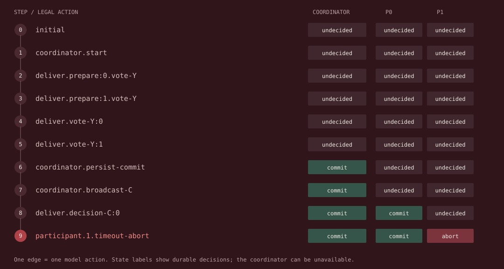

# Transaction protocol model checker

**[View the report in your browser](https://Michaelhoang8.github.io/transaction-protocol-model-checker/)**

A TypeScript finite-state breadth-first search for a deliberately small two-phase commit model. It checks atomic agreement, commit validity, and persistence of durable decisions and votes. Two unsafe variants produce actual shortest counterexamples. A correct-model witness shows why prepared participants depend on coordinator availability.

**[Technical report](docs/report.html)** · [Screenshots](docs/screenshots/README.md) · [Review recording](docs/recordings/README.md) · [Model specification](docs/model-spec.md)



## Completed searches

| Scenario | Participants | Loss / duplicate / crash budget | States | Transition edges | Agreement / validity violating states |
| --- | ---: | --- | ---: | ---: | --- |
| Correct, fault-free | 2 | 0 / 0 / 0 | 76 | 137 | 0 / 0 |
| Correct, bounded faults | 2 | 1 / 1 / 1 | 11,814 | 48,784 | 0 / 0 |
| Correct, fault-free | 3 | 0 / 0 / 0 | 684 | 2,033 | 0 / 0 |
| Commit after a partial vote | 2 | 0 / 0 / 0 | 124 | 233 | 8 / 30 |
| Prepared participant timeout abort | 2 | 0 / 0 / 0 | 127 | 263 | 4 / 0 |

All five searches expanded every discovered state and finished with an empty frontier. All traversed edges satisfy durable monotonicity, including edges in the unsafe variants. This means those mutants isolate agreement and validity failures without also relying on overwritten durable decisions.

These are **completed finite model searches**, not an unbounded correctness proof, TLA+/TLC result, implementation verification, or deployed-cluster experiment. “Correct” names the baseline transition rules under the stated assumptions. No claim extends to unmodeled failures or arbitrary participant counts.

## Reproduce

Use **Node 24**. Node executes erasable TypeScript directly; pinned development dependencies add strict TypeScript checking. There are no runtime packages, credentials, service processes, database servers, or external model-checker installations.

```sh
npm ci --ignore-scripts
npm run typecheck
npm test
npm run check -- --output results-local
npm run replay -- results-local/traces/partial-vote-commit-commit-validity.json
npm run replay -- results-local/traces/prepared-timeout-abort-atomic-agreement.json
```

`results-local/` is ignored. The batch command performs all five searches and replays every saved witness. It exits with failure if any search is incomplete, if a correct-model invariant fails, or if an unsafe variant loses its expected disagreement witness. The CI workflow performs the same fresh search on Ubuntu/Node 24; it does not enforce a runtime threshold.

To replace the committed evidence and render the report:

```sh
npm run check
npm run report
```

The report reads the existing search artifacts; it does not invent or remeasure statistics. `--output` names a dedicated output directory whose evidence files can be replaced. `npm run check -- --help` and `npm run replay -- --help` describe the commands.

## What the model contains

- One transaction, one coordinator, and two or three individually identified participants.
- Durable participant YES/NO votes and final decisions. A YES vote means prepared. A NO vote also durably aborts that participant.
- A durable coordinator decision, a volatile received-vote cache, and a volatile broadcast flag.
- An unordered message **multiset**, so messages can be delivered in any order and duplicate copies remain distinct in multiplicity.
- Optional bounded loss, duplication, and one coordinator crash/recovery. Participant crashes are excluded.
- Nondeterministic YES/NO choices for the first PREPARE, covering every allowed participant vote pattern. A duplicate PREPARE returns the same durable vote.

The coordinator commits only after receiving YES from every participant, or aborts after receiving any NO. Decision persistence and decision broadcasting are separate transitions, making a crash between them representable. A coordinator crash clears only its volatile cache/send flag; messages already in flight remain in the model. Recovery resends PREPARE when undecided, or enables rebroadcast of the durable final decision.

A participant accepts COMMIT only if it has durably voted YES. It never overwrites a final decision. If ABORT arrives before its delayed PREPARE, a participant without a prior vote subsequently responds NO. A participant with a prior durable vote resends that original vote, even after a final abort; this preserves the historical vote without changing its final decision.

Each message delivery is one atomic model transition. Receiving a PREPARE includes durable vote persistence and enqueueing its response. Broadcasting enqueues all participant decision messages in one transition; individual delivery is separate. These atomicity choices are abstractions, not a claim that real network sends or storage writes have those mechanics. See [the full transition specification](docs/model-spec.md).

## Properties checked independently

The [invariant module](src/invariants.ts) reads states and state pairs without calling the transition-enabling rules.

| Property | Checked condition | Count unit |
| --- | --- | --- |
| Atomic agreement | There is no committed participant alongside an aborted participant. | Unique violating states |
| Commit validity | A coordinator or participant commit requires every durable participant vote to be YES. | Unique violating states |
| Durable monotonicity | Once a coordinator decision, participant decision, or participant vote is set, it cannot change. | Traversed violating edges |

Agreement permits unfinished participants. It does not say that everyone eventually decides. Commit validity checks durable participant votes, while the correct coordinator's enabling rule separately requires receipt of all YES messages. Other useful predicates, such as every nonempty participant decision immediately agreeing with the coordinator's decision, are not separate reported properties here.

## Shortest counterexamples

### Commit after a partial vote

The mutation changes the coordinator commit guard from “all received votes are YES” to “at least one received vote is YES.” The earliest commit-validity violation has **four actions**: start, deliver one PREPARE/YES, deliver its YES vote, persist COMMIT. The other participant has not voted.

The earliest participant disagreement has **seven actions**. One participant votes YES and the other NO. Only the YES reaches the coordinator before it commits and sends COMMIT; the YES participant commits while the NO participant remains aborted.

[Four-action validity trace](results/traces/partial-vote-commit-commit-validity.json) · [Seven-action disagreement trace](results/traces/partial-vote-commit-atomic-agreement.json) · [Readable disagreement steps](results/traces/partial-vote-commit-atomic-agreement.txt)

### Prepared participant timeout abort

The mutation adds a local abort action for an undecided participant that already voted YES. “Timeout” names this nondeterministic transition; the model has no clock or elapsed timeout duration.

The earliest disagreement has **nine actions**: start, two PREPARE/YES deliveries, two YES vote deliveries, persist COMMIT, broadcast COMMIT, deliver COMMIT to one participant, and let the other prepared participant abort locally. The latter's commit message is still in flight. Message loss and crash are unnecessary.

[Nine-action JSON trace](results/traces/prepared-timeout-abort-atomic-agreement.json) · [Readable steps](results/traces/prepared-timeout-abort-atomic-agreement.txt) · [DOT](docs/figures/prepared-timeout-abort-atomic-agreement.dot)

Breadth-first search records the first predecessor for each canonical state. The first violation therefore has the minimum number of model actions under the chosen configuration. The four- and nine-action lower bounds also follow from the required causal steps above. Tests assert the known fixture depths, reject tampered witnesses, and include a separate shallow execution-tree search without state deduplication that independently checks the four-action minimum. Minimal action count is not minimal real-world time or message latency.

## Coordinator-unavailable witness

The bounded-fault correct model reaches both participants prepared with an undecided, unavailable coordinator after four actions: start, crash coordinator, deliver PREPARE/YES to each participant. No final-decision message exists. While the coordinator remains unavailable, message loss/duplication cannot let either participant decide.

**Recovery is still enabled. This is conditional blocking, not a global deadlock.** The model makes no fairness or eventual-recovery assumption and does not prove liveness. Its bounded one-broadcast transport can also stall after a dropped message; no general periodic retry mechanism is modeled.

[Blocking witness](results/traces/correct-2p-faults-coordinator-unavailable.json) · [Readable steps](results/traces/correct-2p-faults-coordinator-unavailable.txt)

## Search bounds and algorithm

The [scenario file](src/scenarios.ts) defines all recorded configurations. Loss and duplication budgets count global network actions across the transaction; the crash budget counts coordinator crashes. Recovery is available when down, so one crash permits at most one recovery. The three-participant configuration has no injected transport or crash faults. No experiment silently extrapolates the two-participant fault results to three participants.

The message count is structurally bounded rather than pruned:

- Without coordinator crashes, at most `2N + D` messages: initial PREPARE messages plus decision broadcast plus the duplication budget.
- With one coordinator crash, at most `3N + D`: the initial PREPARE phase plus one recovery resend and a decision broadcast, or the initial phase plus an initial and recovered decision broadcast.
- Delivering PREPARE consumes one message and creates one vote message; other deliveries and losses remove messages. No action can exceed the derived bound. The successor function asserts the bound and throws if the model implementation violates it.

The bounded-fault run observed at most 6 messages against a derived bound of 7. Its maximum first-discovery BFS depth was 16, and its peak pending queue was 2,386 states. “Pending” includes the currently expanding state until all its outgoing transitions have been processed. These are observed statistics, not search-depth or queue-length pruning limits.

The computational guard is **100,000 discovered states per run**, separate from the protocol model bounds. If another new state would exceed it, the checker returns `incomplete-state-limit`, reports its partially processed frontier, and the batch command fails. It never calls that result safe. Tests force tiny limits to verify this distinction. All recorded runs stayed below the guard and completed.

State identity retains participant IDs, durable values, volatile coordinator values, fault counters, and sorted message multiplicity. Canonicalizing only message order removes duplicate representations of the same unordered bag. There is no symmetry reduction, partial-order reduction, heuristic pruning, hidden depth cutoff, or randomized search. The repository saves aggregate counts and selected traces rather than the full graph.

## Evidence and provenance

| Artifact | Contents |
| --- | --- |
| [results/counts.csv](results/counts.csv) | Raw completed-run counts, exact budgets, observed queue/message maxima, elapsed time, and violation units. |
| [results/searches.json](results/searches.json) | Full summaries, first-discovery depth counts, and replayable witnesses. |
| [results/trace-index.json](results/trace-index.json) | All four selected witnesses with scenario, condition, depth and path. |
| [results/traces/](results/traces/) | Every action and full state snapshot in JSON, plus readable text. |
| [results/environment.json](results/environment.json) | Actual measurement timestamp, Node/platform and LF-normalized executable-model source hashes. |
| [docs/figures/](docs/figures/) | DOT and SVG generated from the same witness state sequences. These are witness paths, not full state graphs. |

Elapsed times are one recorded execution per scenario on the local machine, measured with `performance.now`. They establish that the finite searches ran; they are not a model-checker performance benchmark. Counts and witness traces are deterministic for fixed source/configuration; runtime and measurement timestamps vary. SHA-256 source fingerprints normalize CRLF to LF for cross-platform checkouts and omit usernames, hostnames and personal paths.

This is **AI-assisted portfolio work with a synthetic protocol model**. The search, invariant checks, witness replay and tests were actually executed. Screenshots and recordings document inspection of the generated report; they are not a reenactment of historical manual work. No production incident, business improvement, or professional deployment is implied.

## Limits and possible next work

The model excludes participant crashes, disk corruption and partial durable writes, coordinator election, multiple concurrent transactions, acknowledgements and log garbage collection, source code integration, real networking, and performance behavior. It assumes durable state updates are atomic and correctly retained. Its coordinator cache is volatile and reconstructed through vote requests; a different implementation may persist that cache. Its recovery/send abstraction and absence of routine retransmission are intentionally narrow.

Safety over a larger or different model would require changing the transition system, documenting the added assumptions, completing the resulting state space, and rerunning independent checks. An implementation refinement argument, a fairness-aware liveness analysis, or a real fault-injected cluster would be separate work. They are not claimed by this repository.
